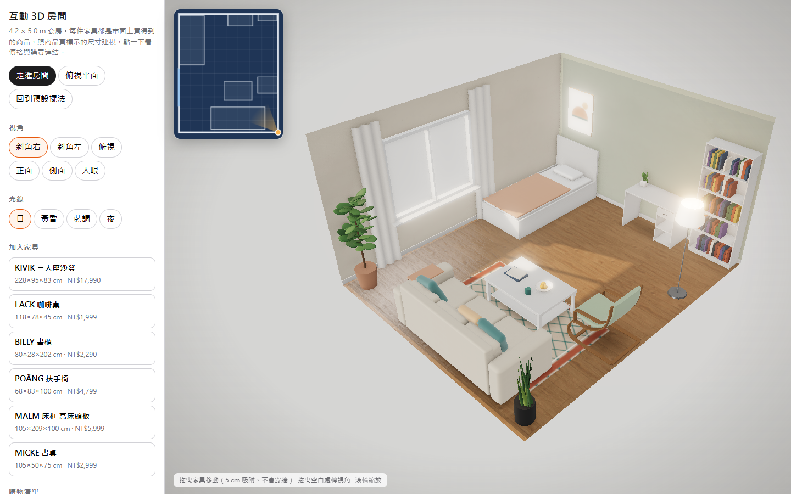

# Interactive 3D room with real products · 互動 3D 房間（真實商品）

**▶ Open the room (no download, no install): https://0smallcat0.github.io/interactive-3d-room/**

Runs in any modern browser, on desktop or phone.

瀏覽器直接開，免安裝，電腦和手機都能用。

A 4.2 × 5.0 m studio furnished with six real IKEA Taiwan products, each built to the size printed on its product page. Prices and product links are shown, with a running total. Each piece is a look-alike model generated from its category and listed size, so you can see how it fits in the room. Walk inside at eye height with a floor-plan map that shows where you stand. The room's daylight is baked in Blender Cycles; furniture gets live sun shadows, so moved pieces still cast correct shadows.

一間 4.2 × 5.0 公尺的套房，放了 6 件 IKEA 台灣真的在賣的家具，尺寸照官網商品頁，旁邊顯示價格、商品連結和總價。家具是照類別和商品頁尺寸生成的類似外形，用來看東西在空間裡怎麼擺。可以用視線高度走進房間，左上角平面圖標出你站的位置；房間的日光用 Blender Cycles 烘焙，家具的陽光影子即時算，搬動後影子照樣對。

How to use · 怎麼用：

| Do this · 動作 | What happens · 結果 |
| --- | --- |
| Drag a piece of furniture · 拖曳家具 | Moves it on the floor; it turns red if it hits another piece · 移動位置，撞到別的家具會變紅 |
| Click a piece, then **旋轉 90°** (or press R) · 點家具再按「旋轉」或按 R | Rotates it · 轉 90 度 |
| Click the desk, then the drawer button · 點書桌再按抽屜按鈕 | Opens / closes the drawer · 開關抽屜 |
| **移除** (or the Delete key) · 按「移除」或 Delete | Removes the selected piece · 拿掉選到的家具 |
| The **加入家具** list · 「加入家具」清單 | Adds another product · 加一件商品 |
| Click a piece (no drag) or a row in the shopping list · 點家具（不拖）或購物清單的列 | The camera flies to it in 0.3–0.9 s, longer for bigger moves; the piece fills the free area beside the panels · 鏡頭 0.3–0.9 秒飛過去，移動越大越久，零件落在扣掉面板後的空場 |
| **視角** buttons · 視角按鈕 | Six views computed from the room's bounding box and fitted to the free area with equal margins: iso right / left, plan, front, side, eye level · 用包圍盒算六個視角，落在扣掉面板的空場、邊距一致：斜角右／左、俯視、正面、側面、人眼 |
| **光線** buttons · 光線按鈕 | Day, dusk, blue hour, night: sun angle and colour, sky, fog, lamps, baked sky light tint · 日、黃昏、藍調、夜：改太陽角度與顏色、天空、霧、燈、烘焙天光的色調 |
| **走進房間** | First-person view at eye height: drag to look, click the floor (or WASD / arrow keys) to walk, click the map to jump there · 第一人稱：拖曳看四周，點地板（或 WASD／方向鍵）走過去，點左上角平面圖直接走到那裡 |
| **俯視平面** | Top-down floor-plan view · 從上往下看平面 |
| Drag empty space / scroll · 拖曳空白處、滾輪 | Turn and zoom the camera · 轉視角、縮放 |
| **回到預設擺法** | Back to the starting layout · 回到一開始的擺法 |

Your layout is saved in the browser automatically. The interface is in Chinese; the table above explains every button.

擺好的位置會自動記住。

Floor, wood and plaster textures: Poly Haven (CC0).

The POÄNG armchair shape is generated by a [Sand3D](https://github.com/Sandflow-ai/sand3d) program (Apache-2.0), kept in `models/poang_sand3d.py`; the room uses the exported GLB scaled to the listed size. Lighting is soft-shadow (VSM) with one warm key light, a fill light and a hemisphere light under ACES tone mapping; ambient occlusion is drawn only on still frames. The camera framing follows [0xwast3/boomtown](https://github.com/0xwast3/boomtown) (MIT).

POÄNG 扶手椅的外形由 Sand3D（Apache-2.0）程式生成，程式放在 `models/poang_sand3d.py`，網頁用它匯出的 GLB 並縮放到標示尺寸。光影是 VSM 軟陰影、單一暖色主光加補光加天地光、ACES 色調映射；環境光遮蔽只畫在靜止的畫面。鏡頭取景做法參考 boomtown（MIT）。

More of my work (mechanical design: CAD, drawings, animation, renders): https://0smallcat0.github.io/mechanical-design-demos/

更多作品（機械設計：CAD、工程圖、動畫、渲染）：https://0smallcat0.github.io/mechanical-design-demos/
