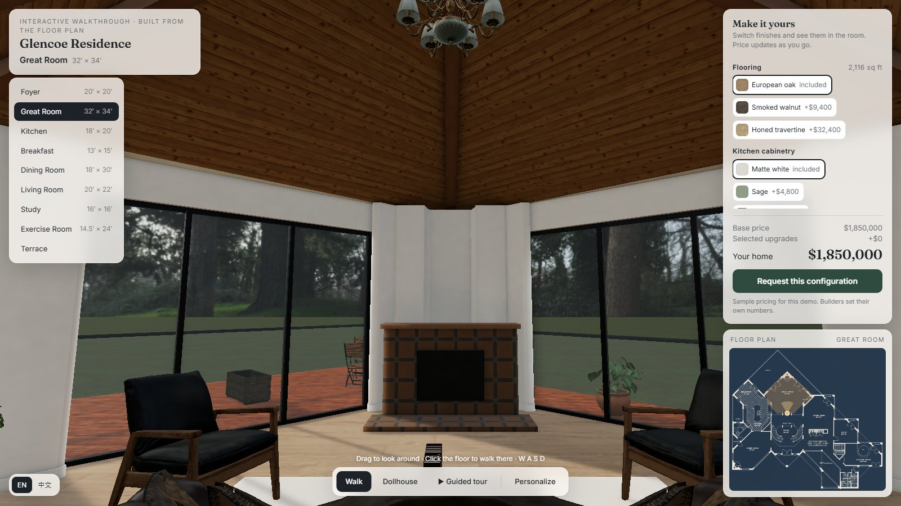

# Floor plan → walk-through 3D home · 平面圖變成可以走進去的 3D 房子

**▶ Open it (no download, no install): https://0smallcat0.github.io/interactive-3d-room/house/**

A real architectural floor plan is traced to scale and built into a complete single-family home you can walk through in the browser. The plan is Gary Berkovich's single-family residence in Glencoe, Illinois (1994).

把一張真實的建築平面圖照比例描成資料，蓋成一整棟可以在瀏覽器裡走動的獨棟住宅。用的是 Gary Berkovich 1994 年設計、位於伊利諾州 Glencoe 的獨棟住宅平面圖。

**What's inside · 有什麼：**

- **The whole house, to scale.** Thirteen rooms and five terraces sit on a 324 m² footprint, and the furniture is placed by the plan's labels.
  - Each room's traced short side matches the dimension printed on the plan within 2–10%.
  - The traced walls overlap the drawn walls at IoU 0.96.
  - 整棟照比例：13 個空間、5 個露台，佔地 324 m²，家具照平面圖標示擺放。各房短邊與圖上標的尺寸相差 2–10%，描出的牆和原圖牆線重合度（IoU）0.96。
- **Light baked in Blender Cycles.** Sunlight from a real sky, bounce light, and warm interior lights are baked into a 4096² lightmap, so it looks right on a phone too.
  - 光線用 Blender Cycles 烘焙：真實天空的日光、反射光和室內暖光烘成 4096² 光照圖，手機上也看得到。
- **Walk, dollhouse, guided tour.** Click the floor to walk there along a real path that goes around walls and furniture. Or flip to a cut-away dollhouse, or press *Guided tour*.
  - 走動／俯瞰模型／自動導覽：點地板就沿著繞開牆和家具的路線走過去；也可以切成掀頂的模型俯瞰，或按自動導覽。
- **The original plan is the map.** The minimap is the architect's drawing, with your position, view direction, and current room highlighted.
  - 小地圖就是原平面圖，標出你的位置、視線方向和所在的房間。
- **Make it yours.** Switch flooring, cabinets, countertops, paint, and the vaulted ceiling. Each finish changes in the room immediately, and the price updates as you go.
  - 選配：地板、櫥櫃、檯面、牆面漆、挑高天花可以換，房間裡立刻換上，總價跟著更新。
- **A lead form that knows what the buyer looked at.** The request records which rooms the visitor spent time in, for how long, and the configuration they chose.
  - 留資表單：送出的紀錄包含訪客在哪些房間停留、各多久，以及選了哪些建材。
- **English / 中文** toggle.

Built with three.js and Blender. Pricing in the demo is sample pricing. The lead form stores the record in your own browser only; nothing is sent anywhere.

用 three.js 和 Blender 做。價格是示範數字；表單紀錄只存在你自己的瀏覽器，不會送到任何地方。

**Credits · 素材來源**

- Floor plan: Gary Berkovich, *Single Family Residence, Glencoe IL* (1994), [Wikimedia Commons](https://commons.wikimedia.org/wiki/File:House_floorpan_by_Gary_Berkovich_(Glencoe,_Illinois).jpg), CC BY-SA 3.0. The traced plan data (`plan.json`) and the recolored map image (`map.png`) are adaptations, shared under CC BY-SA 3.0.
- Furniture models, textures, and the sky (Ballawley Park HDRI): [Poly Haven](https://polyhaven.com), CC0.
